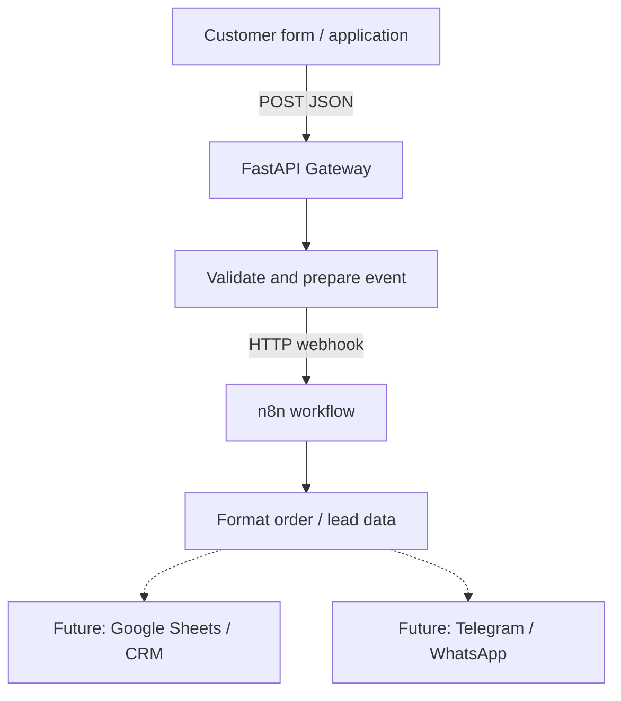

<div align="center">

# Order & Lead Automation Gateway

### From incoming requests to organized workflows.

A beginner-friendly automation gateway built with **FastAPI**, **n8n**, and **Docker**.

[Getting Started](#-getting-started) · [How It Works](#-how-it-works) · [API](#-api-at-a-glance) · [Roadmap](docs/roadmap.md)

</div>

---

## What is this?

Order & Lead Automation Gateway is a small project that helps route incoming customer orders or inquiries into an automation workflow.

Think of it as a front desk for digital requests:

1. A form or application sends customer information to the API.
2. The API checks the information and prepares a consistent event.
3. The event is forwarded to an **n8n** webhook.
4. n8n can then format the information and, as the project grows, pass it to business tools.

The idea is to reduce repetitive copy-and-paste work and give incoming requests a more predictable path.

> **Project status: Early development.** The current implementation includes the FastAPI endpoint, request validation, and an n8n webhook workflow for data formatting. External integrations such as Google Sheets, Airtable, Telegram, and WhatsApp Business API are planned, not currently connected in the supplied workflow.

## Who is this for?

- **Business owners and operators** who want to understand how order and inquiry automation can work.
- **Beginners** learning how APIs connect to visual automation tools.
- **Developers** who want a small FastAPI + n8n project to explore, extend, or contribute to.

## What works today?

| Capability | Status |
| --- | --- |
| Receive order/lead data through `POST /api/v1/orders` | Implemented |
| Validate request fields with Pydantic | Implemented |
| Normalize common Indonesian WhatsApp number formats | Implemented |
| Generate a tracking ID and received timestamp | Implemented |
| Forward event to an n8n webhook | Implemented; check delivery result |
| Format event data in the n8n workflow | Implemented |
| Save records to Google Sheets or Airtable | Planned |
| Send Telegram or WhatsApp notifications | Planned |
| Authentication, durable retries, and production monitoring | Planned |

## How it works



FastAPI handles the API request and validation. n8n handles workflow orchestration. Keeping those jobs separate makes it easier to change the automation flow without rebuilding the API.

## 🚀 Getting started

### What you need

- Docker Desktop, or Docker Engine with the Docker Compose plugin
- Git
- A terminal
- Local ports `8000` and `5678` available

No Python installation is required for the Docker-based quick start.

### 1. Download the project

```bash
git clone https://github.com/gajanpar/lead-order-automation-gateway.git
cd lead-order-automation-gateway
```

### 2. Start the services

```bash
docker compose up -d --build
```

Check that the containers are running:

```bash
docker compose ps
```

### 3. Open the local pages

| Page | Address | What you'll find |
| --- | --- | --- |
| API documentation | http://localhost:8000/docs | Try the API in your browser |
| API health check | http://localhost:8000/health | Check whether FastAPI is responding |
| n8n editor | http://localhost:5678 | View and manage the workflow |

The provided Compose configuration binds the services to localhost. They are intended for local development, not direct public exposure.

### 4. Import and activate the n8n workflow

The workflow file is available at `n8n/workflow_template.json`.

1. Open the n8n editor at `http://localhost:5678`.
2. Import `n8n/workflow_template.json` using the workflow import option.
3. Review the nodes and settings.
4. Activate the workflow in n8n before testing the production webhook URL configured in the API.

Importing a JSON file does not automatically mean the workflow is active. The committed template is inactive (`active: false`).

## Try sending a sample order

Open [http://localhost:8000/docs](http://localhost:8000/docs), find `POST /api/v1/orders`, and use this example:

```json
{
  "customer_name": "Rian Kusuma",
  "customer_email": "rian.kusuma@example.com",
  "customer_whatsapp": "081234567890",
  "service_type": "workflow_automation",
  "budget_estimate_idr": 4500000,
  "notes": "Connect incoming orders to a business workflow"
}
```

Or use cURL:

```bash
curl -X POST "http://localhost:8000/api/v1/orders" \
  -H "Content-Type: application/json" \
  -d '{
    "customer_name": "Rian Kusuma",
    "customer_email": "rian.kusuma@example.com",
    "customer_whatsapp": "081234567890",
    "service_type": "workflow_automation",
    "budget_estimate_idr": 4500000,
    "notes": "Connect incoming orders to a business workflow"
  }'
```

The response includes a tracking ID and `forwarded_to_n8n`.

**Important:** an API response with HTTP `201` means the API accepted the request. It does not guarantee that n8n or a future external service completed its work. Check `forwarded_to_n8n` and the n8n execution history.

## API at a glance

| Method | Endpoint | Purpose |
| --- | --- | --- |
| `GET` | `/health` | Check API availability |
| `POST` | `/api/v1/orders` | Submit an order or lead |

For request fields, validation rules, and response details, see the [API Reference](docs/api-reference.md).

## Project layout

```text
.
├── api/                         # FastAPI application
├── n8n/                         # n8n workflow template
├── docs/                        # Detailed project documentation
├── .github/                     # Issue templates and CI workflow
├── docker-compose.yml           # Local development services
├── CONTRIBUTING.md              # How to contribute
├── CHANGELOG.md                 # Project change history
└── README.md                    # Project home page
```

## Documentation

| Guide | What it covers |
| --- | --- |
| [Architecture](docs/architecture.md) | Services, request flow, and design decisions |
| [API Reference](docs/api-reference.md) | Endpoints, request fields, and responses |
| [Configuration](docs/configuration.md) | Environment variables and Docker networking |
| [Local Development](docs/development.md) | Development workflow and useful commands |
| [Testing](docs/testing.md) | Current test status and how to add tests |
| [Troubleshooting](docs/troubleshooting.md) | Common setup and runtime problems |
| [Security](SECURITY.md) | Security expectations and vulnerability reporting |
| [Roadmap](docs/roadmap.md) | Planned improvements |
| [Contributing](CONTRIBUTING.md) | How to submit changes |

## Current limitations

This project is an early-stage starter, not a complete order-management platform. Before using it with real customer data or exposing it to the internet, address the following:

- The supplied n8n workflow formats events but does not currently write to external storage or send messages.
- API acceptance and downstream delivery are separate outcomes. Inspect `forwarded_to_n8n`.
- The current tracking ID approach should be replaced with a collision-resistant identifier such as UUID or ULID.
- CORS currently permits all origins. Restrict it to trusted frontend origins before deployment.
- The n8n image uses the `latest` tag. Pin a tested version for repeatable deployments.
- Authentication, durable retries, structured logging, automated tests, and monitoring need further work.

See the [Roadmap](docs/roadmap.md) for a more detailed list.

## Contributing

Bug reports, documentation fixes, and thoughtful improvements are welcome. Start with [CONTRIBUTING.md](CONTRIBUTING.md).

## License

This project is licensed under the [MIT License](LICENSE). You are free to use, modify, and distribute this software with attribution.
