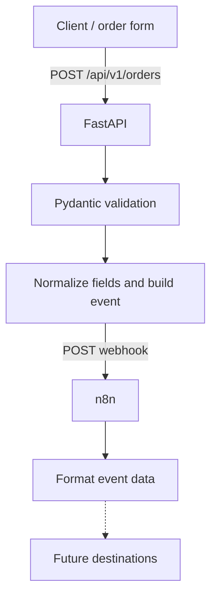

# Architecture

This page explains how a request moves through Order & Lead Automation Gateway.

## At a glance



## Components

### Client

A website, form, script, or API client sends JSON to the FastAPI endpoint. The client does not need to know how n8n works.

### FastAPI gateway

The API is the entry point for incoming requests. It:

- exposes the HTTP endpoints;
- validates the request using Pydantic;
- normalizes the submitted WhatsApp number;
- prepares a tracking identifier and received timestamp;
- attempts to forward the event to the n8n webhook.

### n8n workflow

n8n receives the event and runs the configured workflow. The supplied workflow currently includes a webhook trigger and a Code node that formats the event data and notification text.

The workflow template does **not** currently contain active nodes for Google Sheets, Airtable, Telegram, or WhatsApp delivery.

## Request lifecycle

1. The client sends a JSON request to `POST /api/v1/orders`.
2. FastAPI validates the fields. Invalid requests are rejected by the API validation layer.
3. The API prepares an event containing the submitted data and generated metadata.
4. The API makes an HTTP request to the configured n8n webhook.
5. The API response includes `forwarded_to_n8n`, which indicates whether forwarding was confirmed.

## Two different kinds of success

It is important to distinguish:

- **API acceptance:** FastAPI accepted and validated the request.
- **Workflow delivery:** the API successfully forwarded the event to n8n.

A request can be accepted by the API while forwarding fails. The current implementation does not persist failed events for automatic retry, so it should not be treated as a durable queue.

## Local networking

Docker Compose creates a network for the services. From inside the API container, n8n is reached by its Compose service name, usually:

```text
http://n8n:5678/webhook/lead-ingest
```

Using `localhost` from inside the API container would point back to the API container itself, not the n8n container.

## Design boundaries

The current project is intentionally small:

- FastAPI owns request validation and the public API.
- n8n owns workflow orchestration.
- External systems are future destinations, not part of the current working workflow.

This boundary helps keep API behavior separate from business-specific automation steps.
